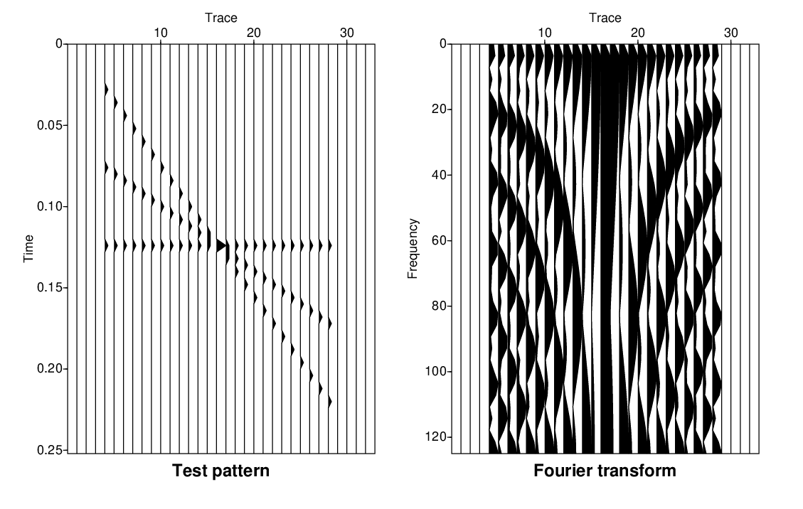

# Introduction to Seismic Unix (SU)
## Getting Started with Unix and SU
In Unix, a program can be executed directly from the command line if it has executable permission and its location is included in the user's `PATH`. You can check the current `PATH` using:

```bash
echo $PATH
```

If SU is set up correctly, we can run a simple example:

```bash
suplane | suxwigb &
```

Here, two important symbols are used:

- `|` is called a **pipe**. It connects the output of one command directly to the input of another command.
- `&` is the **ampersand**, which tells the shell to run the command in the background.

### Understanding the Command Line
The command line is an interactive prompt provided by the shell, where we can enter commands or run programs. The command itself is usually an executable program, either a compiled program or a Unix shell script.

Basically, when the shell shows the prompt, it is saying:

> "Type the program you want to run here."

### Running SU with and without `&`
Try running:

```bash
suplane | suxwigb
```

The seismic plot will appear, but the terminal remains occupied by the running process. To get the command line back, you need to close or terminate the plotting window.

If we add `&`:

```bash
suplane | suxwigb &
```

the plotting program runs in the background. This means we can keep the plot open while still using the command line for other commands.

So, in short:

```text
without &:  terminal → waits for the program to finish
with &:     terminal → available while the program runs in background
```

### Pipe (|), redirect in (<), redirect out (>), and run in background (&)
In addition to the pipe `|`, Unix provides other symbols that allow programs and files to exchange data. The main ones used here are `|`, `>`, `<`, and `&`.

#### Redirecting Output with `>`
The **greater-than sign `>`** is called **redirect out**. It is used to send the output of a program directly into a file.

For example:

```bash
suplane > junk.su
```

This means:

> Run `suplane` and write its output to the file `junk.su`.

Instead of displaying the output or sending it to another program, `suplane` writes the data directly into `junk.su`.

You can think of it as data "pouring out" of the `suplane` program and into the file:

```text
suplane
   │
   │ output
   ▼
  >
   │
   ▼
junk.su
```

#### Redirecting Input with `<`
The **less-than sign `<`** is called **redirect in**. It is used to take data from a file and provide it as input to a program.

For example:

```bash
suxwigb < junk.su &
```

This means:

> Run `suxwigb`, read its input from the file `junk.su`, and run the program in the background.

The data flow is:

```text
junk.su
   │
   │ input
   ▼
  <
   │
   ▼
suxwigb
```

This is basically the reverse of redirecting output with `>`.

#### Summary of Unix Symbols
| Symbol | Name | Function |
|---|---|---|
| `\|` | Pipe | Sends output from one program directly to another program |
| `>` | Redirect out | Writes program output to a file |
| `<` | Redirect in | Reads data from a file as program input |
| `&` | Background | Runs the program in the background |

In short:

```text
|  = pipe data from program → program
>  = write data from program → file
<  = read data from file → program
&  = run program in background
```

For example, these commands can be used together:

```bash
suplane > junk.su
suxwigb < junk.su &
```

The first command generates the `suplane` test pattern and saves it as `junk.su`. The second command reads that file and displays the seismic data using `suxwigb`.

### Stringing Commands Together
Unix commands can be connected using pipes `|`, or by using input and output redirection with `<` and `>`. This makes it possible to build a workflow where the output of one program becomes the input for the next program.

For example, we can use `suspecfx` to calculate the amplitude spectrum of the traces generated by `suplane`:

```bash
suplane | suspecfx | suxwigb &
```

Here, the output from `suplane` is passed directly to `suspecfx`, and the output from `suspecfx` is then passed to `suxwigb` for visualization.

The data flow is:

```text
suplane → suspecfx → suxwigb
```

In this workflow:

- `suplane` generates the test seismic data.
- `suspecfx` calculates the amplitude spectrum by transforming the data from the **time domain to the frequency domain**.
- `suxwigb` displays the resulting data as wiggle traces.

### Using Files Instead of Pipes
The same workflow can also be done by saving the intermediate results into files:

```bash
suplane > junk.su                       # generate suplane data and write it to a file

suspecfx < junk.su > junk1.su           # calculate the amplitude spectrum and write the result to another file

suxwigb < junk1.su &                    # display the final output as wiggle traces
```

This produces the same final output as the previous workflow, but it requires creating two intermediate files: `junk.su` and `junk1.su`.

Therefore, using pipes is generally more efficient when we do not need to keep the intermediate results. It allows the data to flow directly between programs without creating unnecessary files.

The two workflows can be compared as:

```text
Using pipes:

suplane → suspecfx → suxwigb


Using intermediate files:

suplane → junk.su → suspecfx → junk1.su → suxwigb
```

The pipe-based workflow is cleaner and more efficient for temporary data, while the file-based workflow can be useful when we want to save and inspect the intermediate results.

 
(left) The `suplane` test pattern, (right) the Fourier transform (time to frequency) of the `suplane` via `suspecfx`.

## Help Features in SU
Scientific processing and data manipulation packages usually contain many commands. Seismic Unix is no exception. As with any package there are help features to help you navigate the collection of programs and modules. The first thing that you must do with any software package is to locate and learn to use the help features in the package. Usually these help mechanisms are not very “helpful” to the beginner, but are really more like quick reference guides for people who are already familiar with the package. 
### The Selfdoc
All Seismic Unix programs have the feature that if the name of the program is typed with no arguments, a self-documentation feature called a selfdoc is listed. Try:
```bash
suplane
suxwigb
suspecfx
suwind
```

For example:
```text
 SUWIND - window traces by key word					
									
  suwind <stdin >stdout [options]					
									
 Required Parameters:							
  none 								
									
 Optional Parameters:							
 verbose=0		=1 for verbose					
 key=tracl		Key header word to window on (see segy.h)	
 min=LONG_MIN		min value of key header word to pass		
 max=LONG_MAX		max value of key header word to pass		
									
 abs=0			=1 to take absolute value of key header word	
 j=1			Pass every j-th trace ...			
 s=0			... based at s  (if ((key - s)%j) == 0)		
 skip=0		skip the initial N traces                       
 count=ULONG_MAX	... up to count traces				
 reject=none		Skip traces with specified key values		
 accept=none		Pass traces with specified key values(see notes)
			processing, but do no window the data		
 ordered=0		=1 if traces sorted in increasing keyword value 
			=-1  if traces are sorted in a decreasing order 
									
 Options for vertical windowing (time gating):				
 dt=tr.dt (from header) time sampling interval (sec)	(seismic data)	
 			 =tr.d1  (nonseismic)				
 f1=tr.delrt (from header) first sample		(seismic data)	
 			 =tr.f1  (nonseismic)				
									
 tmin=0.0		min time to pass				
 tmax=(from header)	max time to pass				
 itmin=0		min time sample to pass				
 itmax=(from header)   max time sample to pass				
 nt=itmax-itmin+1	number of time samples to pass			
									
 Notes:								
 On large data sets, the count parameter should be set if		
 possible.  Otherwise, every trace in the data set will be		
 examined.  However, the count parameter overrides the accept		
 parameter, so you can't specify count if you want true		
 unconditional acceptance.						
                                                                       
 The skip= option allows the user to skip over traces, which helps	
 for selecting traces far from the beginning of the dataset.		
 Caveat: skip only works with disk input.                        	
                                                                       
 The ordered= option will speed up the process if the data are   	
 sorted in according to the key.                                 	
									
 The accept option is a bit strange--it does NOT mean accept ONLY	
 the traces on the accept list!  It means accept these traces,   	
 even if they would otherwise be rejected (except as noted in the	
 previous paragraph).  To implement accept-only, you can use the 	
 max=0 option (rejecting everything).  For example, to accept    	
 only the tracl values 4, 5 and 6:					
	... | suwind max=0 accept=4,5,6 | ...		   		
									
 Another example is the case of suppressing nonseismic traces in 	
 a seismic data set. By the SEGY standard header field trace id, 	
 trid=1 designates traces as being seismic traces. Other traces, 	
 such as calibration traces may be designated by another value.  	
									
 Example:  trid=1 seismic and trid=0 is nonseismic. To reject    	
       nonseismic traces						
       ... | suwind key=trid reject=0 | ...				
      									
 On most 32 bit machines, LONG_MIN, LONG_MAX and ULONG_MAX are   	
 about -2E9,+2E9 and 4E9, they are defined in limits.h.		
									
 Selecting times beyond the maximum in the data induces		
 zero padding (up to SU_NFLTS).					
									
 The time gating here is to the nearest neighboring sample or    	
 time value. Gating to the exact temporal value requires	 	
 resampling if the selected times fall between samples on the    	
 trace. Use suresamp to perform the time gating in this case.    	
									
 It doesn't really make sense to specify both itmin and tmin,		
 but specifying itmin takes precedence over specifying tmin.		
 Similarly, itmax takes precedence over tmax and tmax over nt.		
 If dt in header is not set, then dt is mandatory	
```

As with the Unix `man` pages, pressing the space bar displays the next part of the help page. There is also a webpage containing a list of Seismic Unix commands and their documentation [here](https://sepwww.stanford.edu/oldsep/cliner/files/suhelp/suhelp.html).