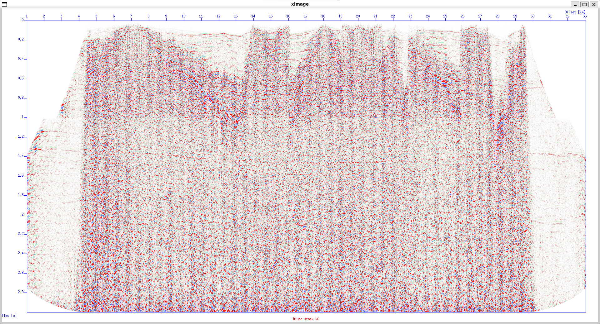

# Deconvolution
Deconvolution compresses the basic wavelet in the recorded seismogram, attenuates reverberations and short-period multiples, and improves temporal resolution, giving a clearer representation of subsurface reflectivity. Beyond simple wavelet compression, deconvolution also helps suppress multiple energy in the seismic section. This process is commonly implemented using an inverse filter as the deconvolution operator, which ideally recovers the earth's impulse response when applied to a seismogram. The inverse filter is typically estimated using the least-squares method.

Mathematically, this can be expressed as:

$$
x(t) = w(t) * r(t) + n(t)
$$

where $r(t)$ is the recorded trace, $w(t)$ is the source wavelet, $r(t)$ is the reflectivity, and $n(t)$ is noise. Deconvolution aims to recover $r(t)$ by minimizing the wavelet effect through inverse filtering.

In practice, deconvolution in Seismic Unix can be performed using the supef command, which applies predictive deconvolution to enhance resolution and suppress short-period multiples. The `decon` script is shown below. The parameters used in the predictive deconvolution process include `minlag` and `maxlag`. To determine these parameters, the autocorrelation of the trace should be analyzed prior to applying deconvolution. The `minlag` is typically chosen based on the time of the second zero crossing after the first peak, while the `maxlag` is selected according to the duration of the reverberations.

```bash
#!/bin/sh

killall ximage
killall xwigb
killall xgraph

# Deconvolution

# Parameter
indata=Line_001_geom_agc_wagc0.5_d2_fk_bpf15,20,70,80.su
ep=150
perc=95
minlag=0.02
maxlag=0.1
pnoise=0.001
ntout=120
tnmo=0.1,1,2
vnmo=1700,2750,3000

#-------------------------------------------
#----------- Before deconvolution ----------
#-------------------------------------------
# Take one shot
suwind < $indata key=ep min=$ep max=$ep | sunmo tnmo=$tnmo vnmo=$vnmo > tmp1
#suwind < $indata key=ep min=$ep max=$ep > tmp1
#-------------------------------------------
# Plot before deconvolution
#-------------------------------------------
suximage < tmp1 perc=$perc title="Shot $ep before deconvolution" label1="TWT [s]" label2="Trace" windowtitle="Shot $ep before deconvolution" &
#-------------------------------------------
# Autocorrelation before deconvolution
#-------------------------------------------
suacor < tmp1 suacor ntout=$ntout | suximage perc=80 title="Autocorrelation before deconvolution" label1="TWT [s]" label2="Offset [m]" windowtitle="Autocorrelation" &

#-------------------------------------------
#----------- After deconvolution ----------
#-------------------------------------------
# Deconvolution
supef < tmp1 minlag=$minlag maxlag=$maxlag pnoise=$pnoise > tmp2 
#-------------------------------------------
# Plot after deconvolution
#-------------------------------------------
suximage < tmp2 perc=$perc title="Shot $ep after deconvolution" label1="TWT [s]" label2="Trace" windowtitle="Shot $ep after deconvolution" &
#-------------------------------------------
# Autocorrelation after deconvolution
#-------------------------------------------
suacor < tmp2 suacor ntout=$ntout | suximage perc=80 title="Autocorrelation after deconvolution" label1="TWT [s]" label2="Offset [m]" windowtitle="Autocorrelation" &

#-------------------------------------------
#----------- Apply deconvolution -----------
#-------------------------------------------
supef < $indata minlag=$minlag maxlag=$maxlag pnoise=$pnoise > ${indata%.su}_decon.su 

rm -f tmp*
```

The autocorrelation below shows that the second zero crossing occurs at 0.04 s, which indicates that the appropriate `minlag` is 0.04 s. The reverberation continues until approximately 0.08 s, which can be used as the `maxlag`.


After applying deconvolution, the temporal resolution increases and the reverberations are suppressed. This improvement occurs because predictive deconvolution effectively compresses the seismic wavelet and removes short-period multiples that obscure primary reflections. 


After some filtering process, we can QC the stack
```bash
#!/bin/sh

killall ximage
killall xwigb
killall xgraph

# Brute stack
data1=Line_001_geom_agc_wagc0.5_d2_fk_bpf15,20,70,80.su
data2=Line_001_geom_agc_wagc0.5_d2_fk_bpf15,20,70,80_decon.su
vnmo=1700,2750,3000
tnmo=0.1,1,2

# Sort to CDP
susort cdp offset < $data1 > tmp1
susort cdp offset < $data2 > tmp2

# Before Decon
sunmo < tmp1 vnmo=$vnmo tnmo=$tnmo | sustack > filter_stack.su
suximage < filter_stack.su perc=90 cmap=hsv5 title="Brute stack V0 after FK filter and BPF" label1="Time [s]" label2="CDP" windowtitle="Brute stack" &

# After Decon
sunmo < tmp2 vnmo=$vnmo tnmo=$tnmo | sustack > decon_stack.su
suximage < decon_stack.su perc=90 cmap=hsv5 title="Brute stack V0 after decon" label1="Time [s]" label2="CDP" windowtitle="Brute stack" &

rm -f *stack.su tmp*
```

### Brute Stack Comparison Before and After Deconvolution


Notice that the reflector is enhanced and multiples are attenuated between 1.2–1.4 s.