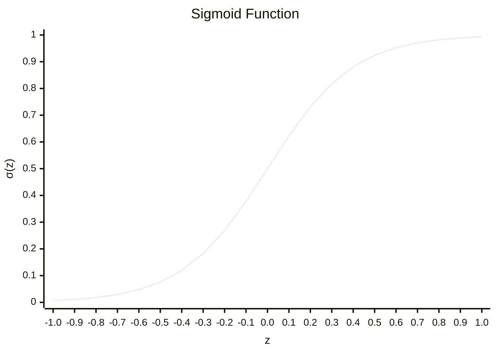

# Neural Network and Machine Learning Appplications in Geoscience

## Introduction to Machine Learning in the Geoscience
There are many of types of Machine Learning (ML) methods fit a nonlinear relationship between input and output data. This is equivalent to a nonlinear regression fitting of data. However, the input-output relationship is not explicitly programmed as, i.e. a weighted sum of polynomials with a specific order. Instead, the ML program learns the fitting function from the data. 

Concurrently, the neuron-function model of the brain has led to the mathematical algorithm known as the perceptron. The perceptron has evolved into the more practical neural network model where, in its simplest form, the $i$-th input electrochemical signal $x_i$ to a neuron is related to the output $y$ by

$$
y = \sigma \left( \sum_i w_i x_i + b \right)
$$

where $w_i$ is the weight to the input $x_i$, $b$ is a bias, and $\sigma (z) = 1 / \left( 1 + e^{-z} \right)$ is the sigmoid function shown in figure below. 

In the original perceptron, the activation function is the all-or-nothing $\sigma(z) = sign(z)$ function, but subsequently it has been replaced by smoother almost-all-or-nothing function such as the sigmoid $\sigma (z) = 1 / \left( 1 + e^{-z} \right)$ where the derivative exist everywhere.

## Three Classes of Machine Learning
Machine Learning methods can be classified into the three classes: supervised learning, unsupervised learning, and reinforcement learning. Researcher are currently exploring their potential applications in three categories of seismic exploration: reservoir analysis, seismic data processing, and seismic interpretation. The supervised ML method often used today in geosciences as well as in image recognition is that of convolutional neural networks.

### Supervised learning
Supervised learning is a procedure for finding a model, for example, finding the coefficients of $\textbf{W}$, that predict the output $\textbf{y}$ from the input $\textbf{x}$. The procedure is denoted as supervised learning because $\textbf{W}$ is found by using a large training set that consists of many training pairs $\left( \textbf{x}^{(n)}, \textbf{y}^{(n)} \right)$ that are much more than the number of unknown weights in $\textbf{W}$.

One use

## Artificial Neural Network