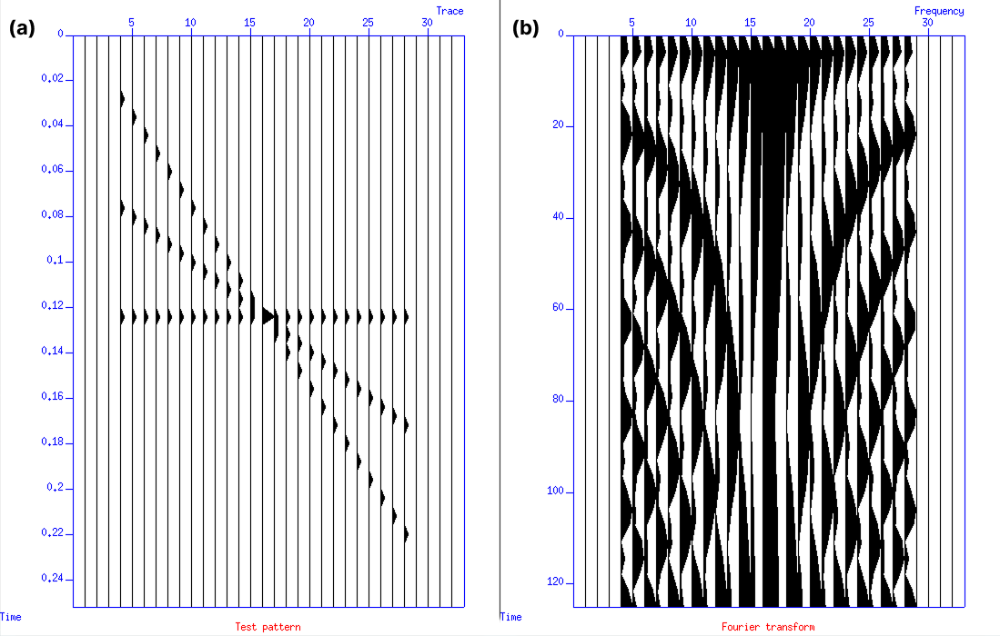

# Introduction to Seismic Unix (SU)
## Getting Started with Unix and SU
In Unix, a program can be executed directly from the command line if it has executable permission and its location is included in the user's `PATH`. You can check the current `PATH` using:

```bash
echo $PATH
```

If SU is set up correctly, we can run a simple example:

```bash
suplane | suxwigb &
```

Here, two important symbols are used:

- `|` is called a **pipe**. It connects the output of one command directly to the input of another command.
- `&` is the **ampersand**, which tells the shell to run the command in the background.

### Understanding the Command Line
The command line is an interactive prompt provided by the shell, where we can enter commands or run programs. The command itself is usually an executable program, either a compiled program or a Unix shell script.

Basically, when the shell shows the prompt, it is saying:

> "Type the program you want to run here."

### Running SU with and without `&`
Try running:

```bash
suplane | suxwigb
```

The seismic plot will appear, but the terminal remains occupied by the running process. To get the command line back, you need to close or terminate the plotting window.

If we add `&`:

```bash
suplane | suxwigb &
```

the plotting program runs in the background. This means we can keep the plot open while still using the command line for other commands.

So, in short:

```text
without &:  terminal → waits for the program to finish
with &:     terminal → available while the program runs in background
```

### Pipe (|), redirect in (<), redirect out (>), and run in background (&)
In addition to the pipe `|`, Unix provides other symbols that allow programs and files to exchange data. The main ones used here are `|`, `>`, `<`, and `&`.

#### Redirecting Output with `>`
The **greater-than sign `>`** is called **redirect out**. It is used to send the output of a program directly into a file.

For example:

```bash
suplane > junk.su
```

This means:

> Run `suplane` and write its output to the file `junk.su`.

Instead of displaying the output or sending it to another program, `suplane` writes the data directly into `junk.su`.

You can think of it as data "pouring out" of the `suplane` program and into the file:

```text
suplane
   │
   │ output
   ▼
  >
   │
   ▼
junk.su
```

#### Redirecting Input with `<`
The **less-than sign `<`** is called **redirect in**. It is used to take data from a file and provide it as input to a program.

For example:

```bash
suxwigb < junk.su &
```

This means:

> Run `suxwigb`, read its input from the file `junk.su`, and run the program in the background.

The data flow is:

```text
junk.su
   │
   │ input
   ▼
  <
   │
   ▼
suxwigb
```

This is basically the reverse of redirecting output with `>`.

#### Summary of Unix Symbols
| Symbol | Name | Function |
|---|---|---|
| `\|` | Pipe | Sends output from one program directly to another program |
| `>` | Redirect out | Writes program output to a file |
| `<` | Redirect in | Reads data from a file as program input |
| `&` | Background | Runs the program in the background |

In short:

```text
|  = pipe data from program → program
>  = write data from program → file
<  = read data from file → program
&  = run program in background
```

For example, these commands can be used together:

```bash
suplane > junk.su
suxwigb < junk.su &
```

The first command generates the `suplane` test pattern and saves it as `junk.su`. The second command reads that file and displays the seismic data using `suxwigb`.

### Stringing Commands Together
Unix commands can be connected using pipes `|`, or by using input and output redirection with `<` and `>`. This makes it possible to build a workflow where the output of one program becomes the input for the next program.

For example, we can use `suspecfx` to calculate the amplitude spectrum of the traces generated by `suplane`:

```bash
suplane | suspecfx | suxwigb &
```

Here, the output from `suplane` is passed directly to `suspecfx`, and the output from `suspecfx` is then passed to `suxwigb` for visualization.

The data flow is:

```text
suplane → suspecfx → suxwigb
```

In this workflow:

- `suplane` generates the test seismic data.
- `suspecfx` calculates the amplitude spectrum by transforming the data from the **time domain to the frequency domain**.
- `suxwigb` displays the resulting data as wiggle traces.

### Using Files Instead of Pipes
The same workflow can also be done by saving the intermediate results into files:

```bash
suplane > junk.su                       # generate suplane data and write it to a file

suspecfx < junk.su > junk1.su           # calculate the amplitude spectrum and write the result to another file

suxwigb < junk1.su &                    # display the final output as wiggle traces
```

This produces the same final output as the previous workflow, but it requires creating two intermediate files: `junk.su` and `junk1.su`.

Therefore, using pipes is generally more efficient when we do not need to keep the intermediate results. It allows the data to flow directly between programs without creating unnecessary files.

The two workflows can be compared as:

```text
Using pipes:

suplane → suspecfx → suxwigb


Using intermediate files:

suplane → junk.su → suspecfx → junk1.su → suxwigb
```

The pipe-based workflow is cleaner and more efficient for temporary data, while the file-based workflow can be useful when we want to save and inspect the intermediate results.

 
(a) The `suplane` test pattern, (b) the Fourier transform (time to frequency) of the `suplane` via `suspecfx`.