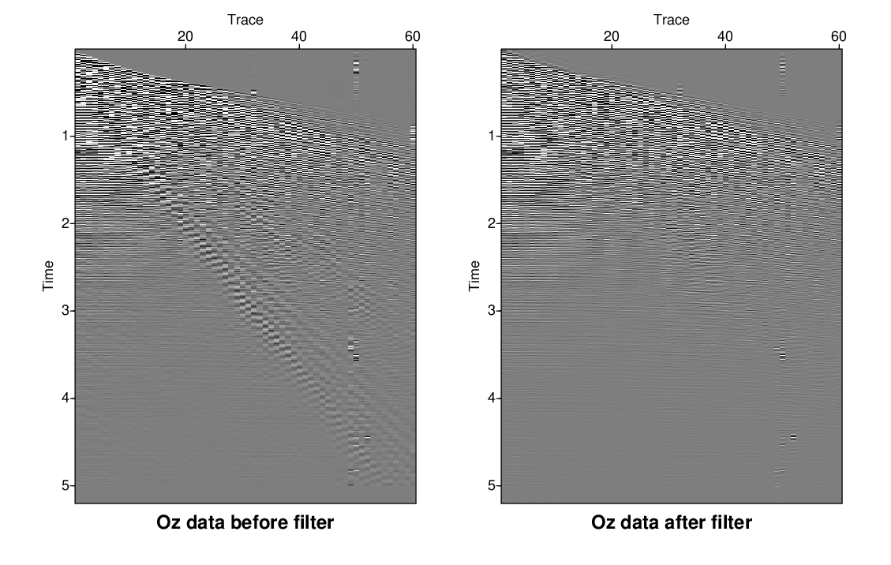

# Shell Scripting and Its Application in Seismic Unix
## What is Shell Scripting?
Shell scripting is basically a way to tell the computer what to do automatically. Instead of typing commands one by one, we can put them into a script that runs in a Unix shell such as `bash`, `sh`, or `csh`.

A shell script can handle file operations, run programs, set variables, and organize multiple commands into a single workflow. This is especially useful when the same processing steps need to be repeated many times.

In short, shell scripting helps us automate repetitive or multi-step tasks, making the workflow more efficient and reducing the chance of human error.

## Application in Seismic Unix
Seismic Unix (SU) is a collection of seismic data processing tools commonly used in geophysics. Shell scripting is widely used with SU because most SU workflows involve running several programs sequentially.

Shell scripting can be used with SU to:

- **Automate Data Processing:** Run multiple SU commands in sequence without having to execute each command manually.
- **Batch Processing:** Process multiple datasets or files by using loops and variables.
- **Workflow Management:** Organize complex processing workflows, such as data conversion, filtering, stacking, and visualization.
- **Reproducibility:** Save the processing steps in a script so the same workflow can be repeated or shared with others.

In essence, shell scripting turns a collection of SU commands into a repeatable, shareable, and more efficient processing workflow.

## Example: Seismic Unix Workflow in Bash
Below is a simple Bash script demonstrating a basic workflow for bandpass filtering seismic data:

```bash
#!/bin/bash

# Shell script for demonstrating a simple bandpass filtering workflow

killall xwigb ximage

DATA_DIR=../ozdata

DATA=$DATA_DIR/ozdata.39.su

IMG_DIR=../img

suximage < $DATA perc=95 title="Oz data before filter" label1="Time" label2="Trace" &

sufilter f=15,20,70,80 < $DATA > tmp1

suximage < tmp1 perc=95 title="Oz data after filter" label1="Time" label2="Trace" &

rm tmp*
```

The output should look like this:

(left) Oz data before before filtering and (right) oz data after filtering.

### Understanding the Script
- `#!/bin/bash` is called a **shebang** (or hashbang). It tells the operating system to use Bash as the shell interpreter for this script.

- `killall xwigb ximage` closes any currently running `xwigb` and `ximage` processes. This is useful for cleaning up previously opened SU visualization windows before starting a new workflow.

- `DATA_DIR=../ozdata` defines the location of the Oz data relative to the directory where the script is being run.

- `DATA=$DATA_DIR/ozdata.39.su` defines the specific SU data file that will be used as the input.

- `$DATA_DIR` is a variable that stores the path `../ozdata`. The `$DATA` variable can then be used later in the script to refer to the input data file.

- `IMG_DIR=../img` defines a directory for image output. In this particular script, however, the variable is not actually used later in the workflow.

- `suximage < $DATA ...` displays the original seismic data before filtering. The `<` redirects the contents of `$DATA` into `suximage`.

- `sufilter f=15,20,70,80 < $DATA > tmp1` applies a bandpass filter to the input data. The filter frequencies are `15, 20, 70, 80` Hz, and the filtered output is redirected to the temporary file `tmp1`.

- `suximage < tmp1 ...` displays the filtered seismic data stored in `tmp1`.

- `rm tmp*` removes files starting with `tmp`. The `*` is a wildcard that matches any sequence of characters.

The script therefore lets us run the whole workflow with a single command instead of manually entering every SU command.

## How to Save and Run the Script
### 1. Save the Script File
Open a text editor such as `nano`, `gedit`, or another code editor and copy the script into a new file.

Save it with the `.sh` extension, for example:

```bash
bpf.sh
```

### 2. Make the Script Executable
In the terminal, make sure the script has executable permission:

```bash
chmod +x bpf.sh
```

### 3. Run the Script
Once the script is executable, run it using:

```bash
./bpf.sh
```

The script will then execute the Seismic Unix commands in sequence and open the SU visualization windows, such as `suximage`.

## What If We Don't Use Shell Scripting?
Without shell scripting, we would have to type every SU command manually for each dataset, parameter change, or visualization step.

For example, if we wanted to apply the same filter to multiple seismic datasets, we would need to repeat the commands for each file. This quickly becomes time-consuming and increases the chance of mistakes, such as using the wrong filename, overwriting a file, or applying inconsistent parameters.

With shell scripting, we can instead:

- Run an entire processing workflow with a single command.
- Change a parameter or filename in one place and reuse it throughout the workflow.
- Apply the same processing steps to multiple datasets.
- Keep a record of exactly how the data were processed.
- Reproduce the same workflow for different datasets or experiments.

For seismic processing, this becomes especially useful as the workflow gets more complex. Instead of treating each SU command as a separate task, we can combine them into one reproducible processing pipeline.