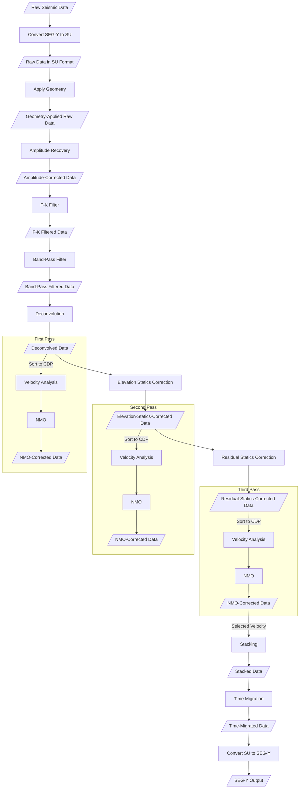

 

# Geophysical Data Analysis 1

Course notes for Geophysical Data Analysis 1 (2025/2026 - 1), taught by Dr. Ayunda Aulia Valencia, S.T., M.T. and Agus Riyanto, M.Si., at the Department of Geosciences, Faculty of Mathematics and Natural Sciences, Universitas Indonesia, for the [Bachelor's Program in Geophysics](https://geosciences.ui.ac.id/program-studi-s1-geofisika/).

The course covers seismic data processing and analysis using Seismic Unix (SU), GNU Octave, and other computational tools. The repository contains lecture notes, practical exercises, scripts, and supporting figures organized by lecture week.

## Seismic Processing Workflow

The following diagram illustrates a conventional seismic reflection processing workflow, from raw seismic data to migrated output. The actual processing sequence may vary depending on the dataset and processing objectives.

## Material

The repository is organized by lecture week. Each numbered directory contains the notes and related materials available for that topic.

| Directory | Topic |
|---|---|
| `01_linux-and-setup/` | Introduction to Linux, WSL installation, and Seismic Unix setup |
| `02_geometry/` | Seismic geometry assignment and application using Octave and Python |
| `03_gain/` | Seismic amplitude recovery and gain testing |
| `04_noise-attenuation/` | Seismic noise attenuation |
| `05_deconvolution/` | Seismic deconvolution |
| `06_velocity-analysis-and-stacking/` | Velocity analysis, normal moveout (NMO), and stacking |
| `07_stolt-migration/` | Stolt migration |
| `09_octave-introduction/` | Introduction to GNU Octave and MATLAB-compatible computing |
| `10_seismic-attributes/` | Seismic attributes |
| `11_neural-network-in-seismic/` | Neural networks in seismic applications |
| `12_spectral-decomposition/` | Seismic spectral decomposition |
| `13_seismic-ray-tracing/` | Seismic ray tracing |
| `14_acoustic-finite-difference/` | Acoustic wave simulation using the finite-difference method |
| `15_velocity-well-tie-and-depth-conversion/` | Velocity analysis, well-to-seismic tie, and depth conversion |

Weeks 8 and 16 are reserved for the midterm and final examinations, respectively.

Additional scripts and figures are maintained in the repository's `Script/` and `img/` directories. Some materials may be incomplete or subject to revision as the course notes are updated.

## Tools and Technologies

- **Seismic Unix (SU):** Seismic data processing and shell-based workflows.
- **GNU Octave:** Numerical computing, signal processing, and seismic analysis. MATLAB-compatible scripts may also be used where applicable.
- **Python:** Supporting scripts and computational exercises.
- **Linux/Unix:** Command-line tools and scripting for seismic processing.

Refer to the individual lecture notes for topic-specific instructions, scripts, and requirements.

## Contributing

Corrections, improvements, and additional examples are welcome.

1. Fork the repository.
2. Create a branch for your changes.
3. Commit your changes with descriptive commit messages.
4. Push your branch and submit a pull request.

## License

No license has currently been specified for this repository. Unless otherwise stated, all rights are reserved by the repository owner.

## Acknowledgments

- Dr. Ayunda Aulia Valencia, S.T., M.T., and Agus Riyanto, M.Si., for teaching Geophysical Data Analysis 1 (SCGF603501).
- The Center for Wave Phenomena (CWP) at the Colorado School of Mines for developing Seismic Unix.

